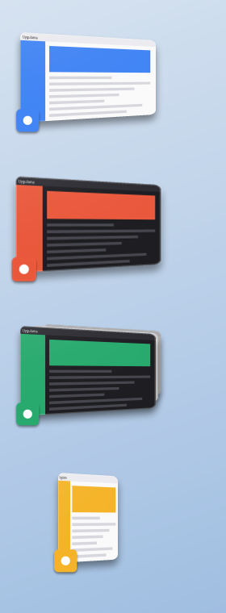

# StageStrip

macOS Stage Manager's way of working, on Windows 10/11. The app you're using stays on stage; everything else waits in a strip on the left as tilted previews.

No installer and nothing to download first: it's a single small `.exe`, built with the C# compiler that already ships with Windows.



*Rendered sample with placeholder windows.*

## Features

- **One app on stage.** Click a preview to switch; the previous app slides to the strip.
- **Every open app stays visible**, even when minimized or closed to the tray.
- **Groups.** Drag a preview to the centre or Shift+click it to use apps side by side. Drag a window onto the strip to take it out.
- **Each display has its own stage** and strip.
- **Click the empty desktop** to clear the stage; click again to bring it back.
- **Hide an app** with `Ctrl+Alt+H`, like Cmd+H. The taskbar or `Alt+Tab` brings it back.
- **Gets out of the way.** The strip hides under windows that overlap it and returns when the cursor touches the left edge. Borderless full-screen apps and games are left alone.
- **Safe to crash.** Original window positions are kept in a recovery file, and the next start puts everything back.

The interface is in Turkish for now.

## Build and run

```
build.cmd
StageManager.exe
```

Settings are in the tray icon's menu. `Ctrl+Alt+Shift+S` turns the app on and off.

| Command | What it does |
|---|---|
| `StageManager.exe --quit` | Closes the running app and restores all windows |
| `StageManager.exe --restore` | Puts windows back after a crash |

## Good to know

- Windows off stage are moved off-screen rather than minimized, because Windows only keeps live previews of windows that aren't minimized.
- Tilted previews refresh about once a second, since Windows' live thumbnails can't be drawn in perspective. Turn off "Eğik önizlemeler" in the menu for flat, fully live previews.
- Windows running as administrator can only be managed if the app itself runs as administrator; the menu can restart it that way.
- A global mouse hook detects desktop clicks. Anti-cheat software may have opinions about that, so consider closing the app while playing protected games.

## Tests

`tests\run-test*.ps1` drive real throwaway windows and the real mouse, so don't use the computer while they run. `tests\render-preview.cmd` draws the look to PNG files without opening any window.

Not affiliated with Apple. "Stage Manager" is Apple's name for its own feature.

## License

[MIT](LICENSE)
